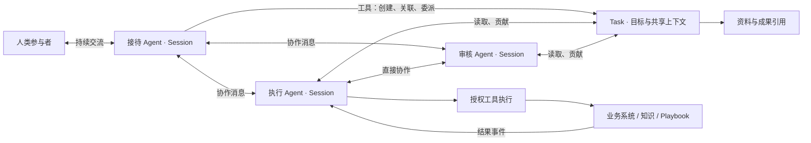

# AgentYard：以 Agent 为交互核心的持续协作架构

状态：**架构决策与本版实现基线，验收已完成**。决策依据：2026-10-04 产品与架构讨论；实现状态更新于 2026-10-05。

本文是当前架构的主设计依据。[代码现状](code-framework.md)记录已经存在的行为，[实施与验收基线](collaboration-acceptance.md)记录实现范围与验证要求。本文描述产品约束；具体字段、工具与接口以现行契约和代码框架文档为准。

## 1. 产品目标与使用方式

AgentYard 支持人和 Agent 围绕持续目标开展工作。参与者可以建立组织关系、共享必要信息、分工、请求帮助、交付成果并作出决定。Task 是工作的线索和信息载体；判断、组织和执行由参与者完成。

用户自然地与持续接待自己的 Agent 交流。接待 Agent 识别需求、查找已有工作、创建 Task、组织执行实例、跟进结果。用户不需要理解 Session，也不需要先建立业务域、场景、助手产品或执行配置。

日常入口不提供“开始新工作”“新建 Session”来要求用户划分工作。已有进展、成果、待回应事项可以被查看和定位；用户也可以直接说“昨天那个继续”“先停一下”“这个结果可以了”。必要的澄清围绕业务意图展开。

接待与专业执行是角色和工作安排的差异，采用相同的 Agent 实例机制。接待 Agent 保持连续交流并关联多项工作；具体执行实例默认专注一项 Task。组织成员可以按权限直接协作，所有消息无需强制经过接待 Agent。

## 2. 已对齐的决策

| 编号 | 已确认的约束 |
| --- | --- |
| D01 | **Session 就是 Agent 的持续上下文实例**，前台接待和后台工作使用同一模型。 |
| D02 | 实例生命周期跟随工作需要；长期存在意味着持久化状态持续存在，内存和进程由调度管理。 |
| D03 | 默认单个执行 Session 专注一个 Task，机制上不限制参与多个 Task；一个 Task 可有多个 Session 协作。 |
| D04 | 用户由持续的接待 Agent 接待；不保留“开始新工作”入口，不要求用户管理 Session。 |
| D05 | Session 维护自己的上下文；Task 保存共享工作信息，黑板属于 Task 内部，不建立独立黑板系统。 |
| D06 | 参与同一 Task 不自动合并 Session 历史；通过贡献、资源引用、定向请求或授权查阅共享信息。 |
| D07 | 人和 Agent 都是参与者；“内部/外部”是关系与授权差异，不是两套参与者运行机制。 |
| D08 | 参与者可以按权限直接沟通、委派和反馈；协调、汇报、审批关系可配置。 |
| D09 | 角色模板与实际权限分离；Agent 的所有外部读写和通信由工具执行边界约束，按操作及对象检查授权。 |
| D10 | Agent 可以从预先配置且获授权的角色模板创建实例和委派工作；本版不默认允许自主发明任意角色及扩大权限。 |
| D11 | 消息、订阅事件、定时触发驱动实例；Agent 可以通过工具登记后续关注和唤醒安排。 |
| D12 | Task 是信息，不作业务判断。执行者自主判断执行是否完成；业务发起者最终确认交付。 |
| D13 | Agent 代用户建 Task 时，用户仍是业务发起者。Agent 自行拆出的子 Task 由该 Agent 发起并确认。 |
| D14 | 确认责任允许显式转交并保留记录；不为此优先建设复杂交接流程。 |
| D15 | 用户自然语言中的明确决定可由接待 Agent 代为执行，保留决定者、执行者与原始依据，检查决定者权限。 |
| D16 | 角色模板独立版本管理；Entry 配置接待与可委派范围，各能力按实际版本引用解析。 |
| D17 | Playbook 保留为可调用的流程工具，支持持久运行、等待与结果回流。 |
| D18 | 人工参与默认是协作；只有明确暂停、取消或接手工作，才改变 Agent 的执行安排。 |
| D19 | 资源的内外来源由具体工具、连接器和存储处理；补齐可定位、可继续使用的引用，不另建内外两套资源模型。 |
| D20 | 移除业务域、场景的强制结构；组织维护成员、共享资源与授权，Task 承载具体工作。 |
| D21 | 直接按目标架构重构，可改动旧数据和代码，不采用保留旧主链、再逐步替换的兼容路线。 |

## 3. 核心对象及边界

| 对象 | 含义 | 明确边界 |
| --- | --- | --- |
| Participant | 可承担工作、发送消息和作出决定的人或 Agent 实例 | 人是系统外部的智能主体；Agent 参与者对应具体 Session，不对应角色模板。 |
| Session | 一个 Agent 实例的身份关联、配置锚点、持续上下文及运行状态 | 不等于聊天窗口、单次模型请求、操作系统进程或 Temporal 的某个 run。 |
| RoleTemplate | 预配置的职责、提示词、工作方法及默认能力引用 | 定义工作方式，模板可用性和工具调用权限另行授权。 |
| Task | 目标、约束、参与关系、共享上下文、进展、成果和决定 | 可承载具体交付、探索事项或长期职责；状态记录参与者的决定。 |
| Organization | 长期成员关系、资源归属、职责与授权范围 | 可以表达团队、部门、公司及跨组织协作；个人使用无须先建立组织。 |
| Resource reference | 可定位的材料或业务对象引用 | 沿用文件、知识文档、外部对象等具体能力；不强制先复制进统一资源库。 |
| Message / Event | 参与者沟通及已发生事实 | 记录发送者、接收范围和关联工作，负责触发相关实例。 |
| Activation | Session 被唤醒后的一段有边界执行 | 是技术执行记录，不再形成无 Session 的第二类 Agent。 |
| ToolRun | 工具或流程的一次调用 | 可同步完成，也可持久等待，通过事件把结果交回调用实例。 |

这些对象按职责拆分，不要求每个对象增加独立服务或独立管理页面。原始消息与 Session 上下文引用应避免无意义复制；资源有明确类型和访问工具，不把所有业务字段塞进一个“万能资源”表。



### 3.1 身份、角色与实例

人类参与者绑定已认证的平台用户或已经验证的渠道身份。保留身份映射来源，不能根据同名、邮箱文本或模型推断自动合并两个人。内部人员、客户、供应商、审核者使用相同的参与机制，能执行的操作由实际授权决定。

Agent 实例创建时同时得到稳定的 Participant 身份和 Session。两条物理记录可以按存储职责分开，但表达的是同一个实例，不再建设另一套独立的 AgentInstance 生命周期。多个 Session 即使采用同一角色模板，也拥有不同身份、上下文、授权和责任记录。

接待关系记录“哪个参与者通过哪个获授权的入口，由哪个 Session 持续接待”。默认持续复用该实例；跨渠道身份合并、组织隔离等路由细节由已验证的身份和授权范围决定，不把“同一个人”硬编码成全平台唯一、跨所有场合共享的 Session。

角色模板可版本化，包含职责、系统提示词补充、Skill 引用和默认工具/模型配置。执行底座统一提供工具协议、消息语义、上下文组装和调度约定。实例保存模板版本及实际解析出的配置；权限变化在工具调用时生效，不能被配置快照冻结成永久授权。

### 3.2 Session 与 Task

两者通过参与关系关联，允许多对多。普通委派默认创建专注目标的实例；相关工作可复用已有实例。不得用数据库唯一约束、API 限制或 UI 强制把两者改成一对一。

接待实例的长期职责是持续理解需求、组织工作和反馈，可以关联多个 Task。执行细节保留在各执行实例，接待上下文主要保留用户沟通、工作索引、关键决定、待回应事项和必要结果。

Session 可以先于 Task 存在。咨询、澄清目标和简单回答不必强制建 Task。需要持续跟进、协作或明确交付的工作，由 Agent 建立相应 Task。新话题不自动清空上下文，也不要求用户重新开会话。

### 3.3 Task 与组织关系

Task 持有目标、约束、参与者、阶段信息、共享内容、成果及决定记录。父子、依赖和相关关系描述工作结构，不自动复制成员、上下文或授权，也不由关系本身自动判定交付完成。

组织维护成员和职责，可以通过明确授权共享角色模板、工具、知识及其他材料。部门层级不等于无限向下读取所有工作的权限；Task 可以包含外部协作者。岗位、上下级、负责人、审核人等关系由实际成员和工作安排表达，不写死一种公司结构。

业务类别可以作为普通分类属性。工作、角色和实例按实际协作需要独立组织。

### 3.4 角色配置与实例化

以下是可预置、可修改的配置示例，不是写死在运行引擎里的 Agent 类型：

| 模板示例 | 默认职责与上下文重点 | 需要另行授权的能力 |
| --- | --- | --- |
| 接待与协调 | 理解用户意图、定位工作、委派、汇总、追问与反馈 | 创建 Task/实例、联系参与者、安排跟进、代理用户决定 |
| 通用执行或研究 | 接收明确目标、调查、整理证据、提交成果 | 读取指定资料、调用业务工具、贡献 Task 内容 |
| 分析或审核 | 读取成果与依据、发现问题、提出意见 | 查阅所需版本和材料、提交审核意见；最终确认权按实际责任授予 |

提供最小可用的接待和通用执行模板作为初始化资料，允许管理员调整或增添领域模板。模板提示词应描述职责、交付习惯和何时请求帮助，不把某个固定组织树、固定数量下属或每次必须建 Task 写成引擎要求。

一次激活的上下文装配建议由执行底座约定、角色模板版本、本次委派目标、实例工作记忆、关联 Task 的获授权内容、当前输入和可调用能力共同组成。工具结果和外部资料保留来源，不能作为修改底座规则或授权的指令。工具清单可以随当前授权过滤，服务端仍执行最终检查。

创建流程由工具完成：校验可实例化的模板与可授出的范围 → 创建 Participant/Session 及配置锚点 → 关联必要工作 → 持久发送委派消息 → 调度首次激活。重复创建请求需要返回同一结果；模型或工具暂不可用时保留清晰状态，不产生一个无法定位的半成品执行。

建议模板更新默认影响之后创建的实例；已有实例保持身份和上下文，其配置变更需记录明确版本与生效点。更换配置不等于更换参与者，权限撤销也不等待模板重新发布。管理员准备模型、工具和入口，普通用户直接进入交流；缺少必要配置时提示可处理的原因，不要求普通用户自行选择发布包。

## 4. 上下文与共享

### 4.1 实例上下文

每个 Session 保存自己的输入、对外输出、工具调用及结果、执行状态、工作记忆和所引用的共享信息。保存的是系统可记录的运行信息，不要求取得或保存模型未公开的内部推理。

持久上下文与一次模型请求的输入分开。长期存在不意味着每次把全部历史塞进模型，也不意味着进程常驻。建议采用：

1. 持久消息、工具记录和执行检查点，支持定位与恢复。
2. 带来源范围和版本的工作摘要，保留目标、重要决定、未完成事项和资料引用。
3. 本次输入、相关近期历史、获授权的 Task 信息及按需检索的旧记录。

压缩或整理上下文不能把历史擅自改写成新的业务事实。需要保留可追溯的来源；摘要失效可以重建。活跃实例的重要工作记忆不能仅依赖 Redis TTL，也不能被通用 transcript 清理定时器静默删掉后假装仍有连续上下文。

历史保留、归档和分页属于落地细节；最低验收是长期实例重启后还能识别已有工作、未完成等待和用户已经作出的决定。

### 4.2 Task 内的共享结构

黑板由 Task 的共享内容实现：事实、材料、问题、假设、方案、讨论、决定、进展和成果可以被持续添加、修订与引用。类型为组织和检索服务，不要求每条自然语言内容都经过固定的多阶段状态机。

每项内容至少能追踪作者、写入时间、修订版本、可见范围和来源引用。不同意见可以并存；Agent 或人作出采用、否决、修订等决定后记录到 Task。共享摘要和成果由参与者通过工具发布，普通获授权贡献无须再增加人工审批。

Task 的状态、共享内容与 Session 的工作记忆各自只有一个权威来源。Session 可以引用某个版本或保存本次实际使用的快照；引用最新内容时要识别变化，不能永久把首次执行选中的内容快照当作全部任务上下文。

### 4.3 跨实例共享

委派至少传递目标、相关 Task、必要背景、可访问资源及期望交付方式。接收方在自己的 Session 内工作。它可以直接请求其他参与者补充，也可以按授权查看相关记录。

共享 Task 不自动公开所有参与者的 Session 历史；协调者也不自动获得所有私有工具结果。传入 Session 的自动背景与显式读取工具使用相同的授权读取机制。内容引用本身不授予读取权限。

工具返回的内容保留来源和范围，发布派生内容时检查适用的共享约束。这里不宣称能仅凭引用字段识别任意自由文本的信息泄漏，也不把权限撤销等同于让模型遗忘已读信息；后续读取和外发操作仍必须受控。

### 4.4 资源引用的落地方式

已有知识服务同时支持上传与 URL 导入，已有连接器支持不同远端协议。继续使用这些能力。Task 里的文字说明和 `uri` 需要补成接收方可识别的引用：内容类型、提供方或工具绑定、对象标识，以及按需携带的版本、名称和摘要。

可通过现有文件服务或对象存储保存文件，通过知识工具读索引/文档，通过连接器操作外部记录。引用不默认提供统一写能力；支持什么操作由具体工具定义。

交付例子：研究实例产生报告 → 保存报告并取得引用 → 在 Task 发布成果 → 审核实例使用对应工具读取 → 审核意见回写 Task。报告的存储位置不改变参与者之间的这条协作链。

## 5. 工具、授权与人的决定

### 5.1 统一执行边界

Agent 对外读取、写入、发消息、创建实例、委派、调度和调用流程都作为工具操作执行。工具目录可以按能力过滤，但“没有展示某个工具”不能替代服务端授权。

建议统一的可信调用上下文包含：

- 实际 Agent Participant、Session 和 Activation；
- 工具、操作、目标对象及本次参数；
- 适用的授权及可转授权范围；
- 存在代理指令时，实际决定者和原始消息关联；
- 幂等请求标识、来源事件、Task 和结果关联。

这些身份字段由系统从已认证的请求与持久记录取得，不能允许模型在普通参数中随意指定另一个调用者。内部工具可以直接调用控制面业务服务，外部工具经连接器；两者复用同一授权语义。人直接操作界面时，也调用同一业务命令与权限检查。

“可以读”与“可以分享”，“可以执行”与“可以授予他人执行”分别表达。创建 Agent 不复制创建者全部权限，角色模板也不自动授予凭证或资源访问。授权收回后，后续工具调用重新检查。

对脚本与流程工具，权限约束需落实到执行环境实际可达的文件、网络、凭证和子工具。一个获授权的脚本工具不能因此获得任意平台管理员能力。

### 5.2 自主执行和代理指令

必须区分两种操作来源：

| 情况 | 决定归属 | 执行归属 |
| --- | --- | --- |
| Agent 在既有授权内调查、贡献、委派 | 当前 Agent 实例 | 当前 Agent 实例 |
| 用户明确要求改目标、暂停、确认成果，Agent 代办 | 作出决定的用户 | 接待或受委托的 Agent 实例 |

代理指令保留原始消息、目标 Task/成果版本、决定类型和结果记录。工具验证消息来源、决定者权限和操作关联；语义理解由 Agent 完成，有业务歧义时澄清。不能让 Agent 通过自填“用户已同意”或引用无关旧消息制造确认。

自然语言确认是正式交互路径。用户不必跳到控制台、填写状态表单或再次点击审批才能表达已经明确作出的决定。界面可展示执行结果和具体对象，便于发现理解偏差。

### 5.3 任务完成与责任

Task 建议区分进行中、等待、已提交待确认、已完成和已取消等状态；最终枚举由契约设计确定。状态更新记录参与者的动作，系统只校验权限、关联版本和事务一致性，不根据自然语言目标自行宣告“已满足”。

- 执行者根据目标自主判断是否可以提交，并说明成果和未解决事项。
- 用户委托接待 Agent 建立的工作，业务发起者是用户，最终确认责任默认属于用户。
- Agent 自行拆分的子工作，发起者是该 Agent；它可以确认子工作，再向上交付。
- 技术创建者、业务发起者、执行者、当前确认责任人分别记录，不能只用 `createdBy` 兼任。
- 确认责任可以显式转交，记录来源和接收方即可，本版不建设独立交接产品。
- 工作失败、一次执行结束、子任务完成和流程工具成功，都不自动等于总 Task 完成。
- 长期工作可以阶段交付与阶段确认，实例和 Task 不因一次交付或短暂空闲自动消失。

评审数量和子任务完成情况不作为所有工作的统一验收门槛。特定业务如确有这些要求，应由参与者的工作约定和获授权的确认动作体现。

## 6. 消息、唤醒与运行

### 6.1 一套运行链路

所有 Agent 激活都关联真实的 Session：

```text
输入消息 / 被关注的变化 / 定时到期 / 工具结果
  → 持久化输入与投递记录
  → 路由到接收者的 Session
  → 创建 Activation，读取检查点与获授权上下文
  → 模型与工具循环
  → 保存可恢复的执行记录、输出与后续等待
  → 派发消息、贡献或唤醒事件
```

接待和后台执行只在消息来源、角色职责和输出接收者上不同。每次执行都必须绑定真实 Session，并启用完整持久 transcript。

实例休眠、单次 Activation 完成、工具等待、Task 等待是不同状态。一个工作长期等待时，持久状态仍存在，计算资源可以释放。已结束的 Temporal run、进程重启、历史分段都不能直接终结业务 Session。

当前执行通过 `activation_finish` 明确交代完成、等待、受阻或需要续算；普通进度文字不是完成信号。暂时性失败或单段预算结束可在同一 Activation 内有界恢复。默认最终回复与显式回执共用投递收敛规则；Task 的 SUBMIT 与人的确认仍是独立业务动作。具体协议、版本失效与实际运行状态查询见[运行收敛机制](activation-completion.md)。

### 6.2 事件投递

消息建议记录发送者、接收者或接收范围、来源事件、关联 Task、回复关联和内容/资源引用。人类接收者通过 Web 或渠道收到消息；Agent 接收者通过对应 Session 被唤醒。多人交流的可见消息与各实例私有上下文分别维护。

外部渠道负责认证身份、归一化输入、投递输出和回执。渠道 conversation ID 是传输关联，不再等同 Agent 实例边界。保持已有 Channel Provider / Tool Connector 扩展机制，不在本轮另造消息总线服务。

投递持久化后再调度。沿用 PostgreSQL 事务发件箱与 Temporal 的基础能力，Redis 用于通知、缓存和协调，不作为唯一消息、等待或决定存储。重复投递需要幂等；失败、待投递、已接收和业务处理结果应能区分。

### 6.3 订阅与定时

Agent 可以通过工具订阅相关 Task、资源或外部事件，也可以安排后续唤醒。记录接收实例、触发条件、有效期、作用范围和授权来源；可以查询、取消和修改。

触发只带来新的输入，不自动证明业务条件已经满足。Agent 收到变化后判断下一步。停止或取消工作时，需要处理相关订阅、等待和后续安排，防止已取消工作被旧事件重新启动。

这是一项已有授权范围内的能力，不默认开放无限递归创建实例、无限定时或无限模型调用。容量和执行预算采用通用调度配置；不以低层预算耗尽静默标记业务完成。

### 6.4 连续性与并发的实现建议

单个 Session 的上下文提交采用有序推进和检查点，避免两个执行分支各自覆盖共同记忆。外部工具和多个实例可以并行；输入到达时先持久记录。具体排队、中断和工具等待时的处理策略由实现验证决定，这不是“一个 Session 必须只有一个 Task”的约束。

一个 Activation 不强制等于完整业务任务，也不保证进程中断后从任意模型 token 精确续算。应从已记录的输入、工具回执和检查点恢复；对结果不明确的外部写操作先核对回执，不能盲目重复副作用。

## 7. Playbook、人工参与和其他能力

### 7.1 Playbook 作为流程工具

保留版本化节点图、脚本、工具节点、人工等待和外部回调能力。Agent 通过工具传入明确输入，获得 ToolRun 引用；进度、等待、失败和终态结果以事件回到原 Session。

流程等待的人工信息通过参与者消息关联具体等待点。回调由连接器或渠道入口认证，定位 ToolRun 和等待实例；不能凭一个 Task ID 恢复所有等待。

每个流程调用有独立 ToolRun；同一 Session 可同时关联多个调用，Agent 身份保持不变。并发数量由实际授权和资源配置决定。调用与恢复检查当前授权，流程内的工具不能因包在图里而绕过检查。

Skill 继续承载按需读取的工作方法和提示上下文；RoleTemplate 承载默认职责；Playbook 承载明确步骤。保留这些不同能力的实际用途，避免把所有探索性工作都画成固定流程。

### 7.2 人工协作

提问、补充材料、审核意见和确认结果都是参与者输入。请求人工帮助可以使某项工作等待，但不自动令整个实例进入客服接管状态。收到反馈后在原上下文继续。

有权的人明确要求暂停、取消或亲自接手时，记录其指令并改变执行安排。人接手的是工作责任，不能成为该 Agent Session 的“新 Owner”。接手后 Agent 是继续辅助、等待还是停止，由具体指令确定。

### 7.3 入口、配置与基础能力

Entry 承载入口名称、渠道和默认接待角色。普通用户看见接待入口；管理员按权限配置角色模板、模型、工具、知识、组织和渠道。管理界面支持真实配置需求，不是每次工作的必经路径。

组织中的权限角色与 Agent 的角色模板在命名和 API 中区分。模型、知识、Skill、工具和流程保持各自的版本与引用，创建实例时解析所需配置。

已有隐私映射、密钥管理、扩展注册、知识导入和检索继续服务新链路。其凭证和数据保护职责不因入口改造被取消，也不成为普通用户新增的操作步骤。

## 8. 建议的持久化与契约结构

以下为逻辑结构，最终表名和字段由实现统一确定；不要据此在旧模型旁再复制一整套临时实体。

| 逻辑记录 | 主要信息与约束 |
| --- | --- |
| Participant / IdentityBinding | 人或 Agent；可信外部身份映射；Agent 与 Session 一对一身份关联；停用状态。 |
| RoleTemplate / Version | 职责、提示词、Skill 和默认能力引用、版本；可实例化授权独立。 |
| Session | Agent Participant、模板版本、实际配置、生命周期、上下文检查点、创建依据。 |
| ReceptionBinding | 人类参与者、授权入口/接待范围、接待 Session；不在角色改变时偷偷重建用户历史。 |
| Task / Participation / Relation | 目标、状态、阶段、参与关系、任务关系；业务发起者、技术创建者、当前确认责任人。 |
| TaskContent / Revision | 内容、成果引用、作者、来源、可见范围、版本；共享黑板由此实现。 |
| Message / Delivery / Event | 来源身份、接收范围、关联工作、回复链、投递状态、幂等标识。 |
| Activation / Transcript / Checkpoint | Session、输入事件、执行状态、实际上下文引用、模型与工具记录、结果或失败、恢复点。 |
| Grant | 主体、操作、对象范围、授权者、可转授权范围、有效期与撤销状态。 |
| Decision | 决定者、代理执行者、原始消息、目标及版本、决定内容和落地结果。 |
| ToolRun / Wait / Schedule | 调用 Session、工具版本、输入结果、等待关联、触发条件与后续事件。 |

权威边界：

- 控制面和共享持久化模块负责参与者、授权、Task、消息和对外执行状态。
- Runtime 维护可恢复的模型/工具 transcript，并通过检查点和 Activation 与控制面关联。
- Temporal 负责持久调度、等待及执行编排，不代替业务记录。
- 知识服务负责文档、索引及内容快照；对象存储负责相应文件。
- UI 和接待 Agent 读取同一业务记录，不能各自维护一份任务进度真相。

所有 Agent 操作通过工具适配进入共享业务服务，不能为聊天工具、Task 页面和流程节点分别复制授权/决定/内容修改逻辑。同类逻辑出现三次时必须收敛到共享实现。

## 9. 实现分层

- `AgentContracts` 定义持续实例、Activation、消息、授权、安排及 ToolRun；`TaskContracts` 定义工作信息、角色、共享内容与决定；`RuntimeContracts` 定义实际运行使用的能力和消息值对象。
- 控制面统一承接人的直接操作与 Agent 工具调用，事务化提交业务效果和操作回执。
- 所有模型调用经真实 Session 的 Runtime transcript 记录；Temporal 每次有界执行及长工具等待不改变 Agent 身份。
- 渠道将已验证外部身份映射为人类参与者，以 Entry 恢复持续接待；最终交付来自持久消息。
- Web 提供持续交流与统一收发记录，专业 Agent 可以直接联系参与者；管理配置不成为普通用户每次工作的入口。

实现和验收以[代码框架](code-framework.md)与[工作包](collaboration-acceptance.md)共同追踪。对数据、接口与页面采用直接架构替换，不维护两条并行的业务运行主链。

## 10. 一条完整使用链路

1. 用户向接待 Agent 说：“调研三家供应商，整理建议，预算五万元。”
2. 接待实例根据已有交流明确需求，通过工具创建 Task；发起者记录为用户，操作执行者记录为接待 Agent。
3. 接待实例从获授权的研究、分析模板创建专用 Session，委派目标、必要背景和资料引用。
4. 研究实例调查并在 Task 贡献证据；分析实例按权限读取。两者可以直接询问和反馈。
5. 分析实例发现预算口径不明确，向用户请求说明。用户在原接待入口回复，消息关联回对应工作和接收实例。
6. 后台服务重启。等待记录、工具结果、实例上下文和投递状态仍在，恢复后继续。
7. 用户又说：“采购继续，另外看看新的市场。”接待 Agent 识别已有 Task，并为新需求组织适当工作；有业务关联歧义时澄清，不要求用户选择新 Session。
8. 执行实例提交成果，相关子工作由发起它们的 Agent 确认，接待 Agent 汇总反馈。
9. 用户说：“采购方案可以了，确认完成。”接待 Agent 执行对应决定，记录用户、原消息和成果版本。
10. 采购 Task 完成；其他工作继续；接待 Session 保持存在。迟到的旧事件不能把已取消或完成的工作悄悄重新启动。

## 11. 实施范围、验证与后续演进

本版应交付完整的接待、委派、协作、持续上下文、工具授权、唤醒、人工决定及成果闭环，覆盖代码、契约、数据库、前端、部署配置、站点说明和测试。具体工作包与场景编号见[实施与验收基线](collaboration-acceptance.md)。

生产部署矩阵、高级成本优化、复杂组织交接、角色自我进化、治理报表和大规模性能调优放在后续。持久恢复、授权、身份归属和必要幂等属于主链正确性，本版必须实现，不能以“稳定性以后再做”为由省略。

以下选择由实现依据代码和验证结果决定，无需再逐条请求产品确认：具体表名、状态枚举、检查点格式、Temporal 历史分段、工具命名、资源引用编码、分页和事件分发细节。它们不得改变本文已确认的使用方式与责任边界。

若遇到真实冲突，应记录具体场景、现有约束和候选处理方式，再一次对齐一个影响产品行为的问题。不要因方便复用旧代码重新引入已排除的入口或概念。
