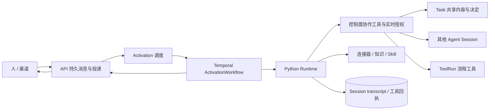

# 当前实现：持续 Agent 实例与协作运行链

更新：2026-10-05。本文描述仓库实际代码。本版核心实现与集成验收已完成；范围见[实施与验收基线](collaboration-acceptance.md)。产品约束见[架构决策](agent-collaboration.md)。

## 1. 主运行链



API 的 `platform.agent` 是统一实例与消息入口。`AgentService` 创建真实 `agent_session` 与对应 Agent Actor；同一模板创建的两个实例具有不同身份和上下文。`AgentDispatcher` 从数据库取未派发输入，通过稳定 workflow ID 启动 Temporal。`ActivationWorkflowImpl` 在同一 Activation 中按持久检查点执行有界模型/工具循环，最多六段自动续执行，并独立重试结果提交。模型必须用 `activation_finish` 明确完成、等待或受阻；普通进度文字不能作为完成信号。详见[运行收敛机制](activation-completion.md)。

接待、专业执行、定时跟进和工具返回都通过这一条链路。Session 生命周期为 ACTIVE / PAUSED / CLOSED；Activation 为 QUEUED / RUNNING / SUCCEEDED / FAILED / CANCELLED。空闲不删除 Session。一个 Session 可以关联多个 Task；默认委派围绕一个工作组织，数据库没有一对一限制。

## 2. 权威存储与并发

| 内容 | 权威位置 |
| --- | --- |
| 实例、身份、Task、消息、授权、决定、安排与 ToolRun | Core PostgreSQL，`AgentStore` / `TaskStore` |
| 模型输出、工具输入/结果、工作摘要与副作用回执 | Runtime PostgreSQL，`transcript_store.py` |
| 编排、长工具等待、执行重试 | Temporal |
| 渠道身份、会话路由、发送回执 | Core 可信身份映射及 Channel Gateway PostgreSQL |
| 文档、索引与知识快照 | Knowledge Service PostgreSQL / 对象存储 |
| 通知、短期缓存与 HTTP 登录 Session | Redis；不作为业务上下文唯一副本 |

`agent_activation` 的部分唯一索引保证每个实例只有一个 RUNNING Activation。行锁领取输入，全局数据库锁限制跨 API 实例的运行并发；后续输入先排队，不覆盖正在执行的上下文。暂停 Task 不影响同一 Session 处理其他仍活跃的关联工作。

控制面的协作工具由 Spring 事务包住业务效果与操作回执，包括跨 Task、实例、授权和消息服务的调用。相同调用 ID、相同参数重放返回原结果；不同参数冲突。Runtime 对外部工具另存调用回执，对结果不明确的副作用保留不确定状态，不用盲重试掩盖故障。

模型/工具历史按真实 Session 和参与者保存。Redis 清空或进程重启后从 PostgreSQL 恢复；工作摘要带来源范围，历史可分页查询。工具中更新的工作记忆不会被结束时的旧全量快照覆盖，Activation outcome 只携带 patch。

模型自动上下文使用 Task 概览、共享内容版本引用、最近决定和 ToolRun 摘要。正文、较早决定及工具结果按需分页读取，避免把每个 Task 的全部资料反复塞入提示词。Runtime 对模型视图实施字符预算，省略时给出来源和取回方法；持久 transcript 与原始回执保持完整。

## 3. 配置与权限

独立对象为 RoleTemplate、RoleTemplateVersion、Entry、Playbook/Version、Resource/Version、KnowledgeBase/Release。

- RoleTemplateVersion 固定职责、提示词及精确能力版本引用；已有实例保留选定版本。
- Entry 指定接待模板、允许创建的模板以及可执行/可转授的能力范围。持续接待按人类参与者与 Entry 绑定。
- 模型资源配置 provider、modelId、baseUrl、apiKeyEnvVar。密钥来自 Runtime 进程环境，不来自角色提示词或用户消息；没有全局模型替代配置。
- `AgentAuthorization` 校验操作、对象范围、有效期和父授权链。模板挂载一个工具不会自动取得使用权。
- Entry 的策略更新不要求重建实例；新增范围在接待恢复/上下文装配时同步，收紧和撤销在实际工具调用时重新检查。显式撤销的授权不会被自动恢复。
- 个人/组织配置归属由 `CatalogAccess` 处理。平台角色门禁与对象范围各自校验，组织权限不依赖预设业务域。

`CapabilityAccess` 校验挂载版本与实际权限。Skill 正文、知识、Session 历史、连接器操作和流程节点均经过授权。模型可见资源说明不包含连接器凭证；实际调用配置只通过可信服务通道发送到 Runtime。

## 4. Task、共享信息和决定

Task 保存目标、阶段、属性、状态、参与者、关联工作及共享内容。内容有类型、作者、修订、可见角色、来源和状态；正文使用结构化对象，例如 `{"markdown":"..."}`。Task 不执行模型判断。

`TaskCommandService` 处理带 expectedRevision 的命令。内容变化会使已经提交的成果重新进入 ACTIVE，旧 contentRevision 不能被确认到新成果上。父子/依赖关系防止循环，但不存在统一的“所有子任务结束才可确认”门槛。

业务发起者 `initiatedBy`、技术创建者 `createdBy`、当前确认责任人 `confirmerId` 分开存储。人委托 Agent 创建根 Task 时保留原人作为发起者；Agent 自主创建的子工作由该 Agent 负责确认。

代理决定必须引用当前 Activation 的真实人类输入，服务端核对原消息、接收实例和目标权限。`Decision` 记录决定者、执行者、原消息及成果版本。Agent 自主提交不等于代替人确认；明确的人类自然语言指令可以直接落为确认、返工或阶段决定。

返工命令持久通知原提交者，无需事先订阅；通知与该实例已有订阅去重。决定历史使用稳定游标完整读取，Task 详情只展示最近一段。

共享 Task 不公开所有参与实例的 transcript。内容版本按权限读取，派生内容使用来源引用时不能扩大原可见范围。自由文本的语义泄漏无法仅凭引用字段完全识别，发布行为仍需 Agent 遵循实际范围。

## 5. 消息、控制与安排

日常入口为 `/api/agent/reception`。无绑定时创建接待实例，后续恢复同一实例。公开查询返回该人的持久收发记录、参与者显示信息和相关执行状态，不返回接待实例的私有工作记忆。较早消息可分页读取，SSE 从数据库重查，断线后不依赖进程内缓存找回信息。

专业 Agent 可以直接询问人或其他 Agent。Web 的默认编辑区向接待实例发送；对具体消息使用“回复”时保留实际接收者、Task 和回复来源。接待实例不会自动取得其他实例的私有历史。

自动结果沿负责接收结果的关系返回。RESULT 不自动对发送方再发确认回声，新的协作请求通过显式消息建立，防止 Agent 相互致谢而持续唤醒。非取消的执行失败也形成持久通知，责任实例或人可以据此查看已有回执并决定后续处理；通知不泄漏底层服务诊断。

定时安排、订阅及未派发事件持久化。当前订阅源为 Task 变更、资源/知识/流程配置变更和角色模板变更；按订阅时点、事件类型及现有权限过滤。通知只携带授权后的引用/元信息，接收者重新读取当前内容。错过多个周期时合并成一次唤醒，避免离线后大量补发。

暂停、取消与关闭是明确控制动作。暂停保存输入与上下文；恢复时提醒实例核对中断回执后继续。工作或实例关闭后处理关联执行与等待，迟到完成不能重开旧工作。通用并发和模型步骤预算控制计算资源，不限制持久实例的存在时间。

调度按稳定游标轮转，暂停项在领取数量限制前排除。启动与取消按执行行锁排序，workflow ID 禁止复用；取消事实先持久化再投递。暂停意图以 PENDING 保存，只有收到投递回执才更新已应用状态，丢失回执时重发当前控制状态。Activation / ToolRun 的真实完成回执与取消决定分别保存，迟到结果和用量保留而不重新唤醒关闭工作。

## 6. 流程与资源

Playbook 通过 `tool_run_start` 成为独立 ToolRun，可与同一 Session 的其他工具并存。Worker 保留脚本、连接器节点、人工等待和外部等待，脚本继续由 `SandboxGateway` 执行。每个节点调用前重新授权，身份与 Agent Session 保持不变。

节点效果执行前遇到暂停返回 423，工作流保留 executionId 等待恢复；已进入执行的外部写入不按这个信号盲重试。暂停期间收到的工具结果和等待事件照常入队，恢复后由原实例处理。

人工等待必须由实际人类消息提供来源；外部等待通过[已认证的外部回调](external-interaction-integration.md)核对等待点、扩展描述符、账号及幂等事件。结果和等待通知回到调用 Session，由 Agent 决定下一步；流程成功不自动完成 Task。

Task 内报告的可用引用示例：

```json
{"kind":"TASK_CONTENT","taskId":"...","entryId":"...","revision":3}
```

另一实例用 `resource_read` 读取该版本的真实正文，再写入审阅。工具引用使用 `{"kind":"TOOL","resourceId":"...","operation":"read_document"}` 取得可用操作说明，实际对象内容由对应工具按对象 ID 读取。知识、Skill 和 Session 历史使用各自明确的能力；引用本身不授予权限。

## 7. 模块与接口

| 模块 | 实际入口 |
| --- | --- |
| 日常交流与实例 | `AgentController`，`/api/agent/*` |
| 业务协作 | `CollaborationController`，`/api/collaboration/*` |
| 内部 Activation、工具与 ToolRun | `InternalAgentController`，`/api/internal/activations/*`、`/api/internal/tool-runs/*` |
| 独立配置 | `/api/role-templates`、`/api/entries`、`/api/playbooks`、资源与知识接口 |
| Python 执行 | `/activations/execute`、`/activations/execute-stream`、`/tool-run-nodes/execute` |
| Python 历史 | `/sessions/{id}/history`、`/sessions/{id}/summary`，内部认证及实例身份校验 |
| 渠道 | 已验证身份 → Entry 接待 → 持久 collaboration_message → durable frame/ACK |

共享 JVM 契约为 `AgentContracts`、`TaskContracts`、`RuntimeContracts`；后者只承载实际使用的能力、消息、隐私、用量和流程值对象。

## 8. 验证与后续边界

`AgentIntegrationTest` 与 `CollaborationServiceTest` 使用真实 PostgreSQL；前者使用生产相同的 Spring/Jooq 事务机制，覆盖并发接待、串行上下文、事务回滚、撤权、代理确认、直接人工回复、订阅、调度及关联多 Task。渠道测试包含专业实例直接向已验证渠道人类身份发消息。

跨语言测试使用真实 HTTP、PostgreSQL、Redis、Temporal Worker 与 Python lifespan/transcript。确定性模型用于稳定复现分支，DeepSeek 使用真实工具调用单独验收。最新范围和未验证项以实施计划及测试报告为准，不把某一层测试通过等同于完整交付。

当前仍是 alpha：组织与授权提供基础协作结构；不包含完整企业组织产品、多租户商业交付、高级成本治理和生产 SLO 平台。已授权的共享内容、身份隔离、持久上下文与执行正确性属于本版主链。
